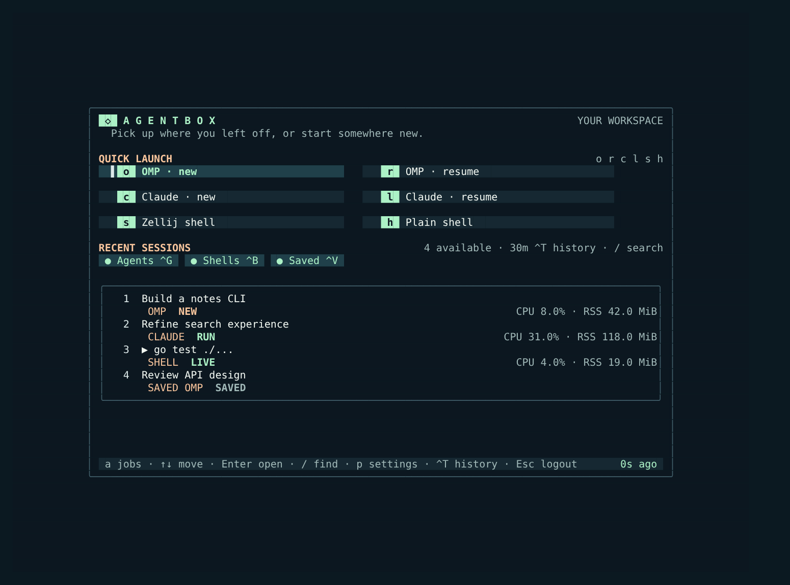

# agentbox

An agentbox is a dedicated Linux VM that hosts coding agents (Claude Code, Codex, omp) for one person who only ever reaches it remotely, from a laptop or a phone, through SSH and Zellij. It runs on a small home hypervisor, keeps agents busy while you are away, and is disposable: everything that matters lives in git.

This repository describes what an agentbox consists of and holds the tooling for working with one. It is meant as a reference: point an agent at a hypervisor (Proxmox or similar) and a fresh VM, give it the skill below with your own values filled in, and it can rebuild the same setup. There is deliberately no step-by-step installer; the skill describes the finished box, and the agent works out how to get there on your hardware.

## What is here

| Path | What it is |
|---|---|
| [`skills/agentbox/`](skills/agentbox/SKILL.md) | The agentbox skill (Agent Skills format): layout, SSH workspace, packages, runtimes, Docker, browsers and virtual desktops, background and scheduled agents, networking, telemetry, resource limits, recovery. Edit the "This box" table and the topology template for your own machine. |
| [`login/`](login/README.md) | `agentbox-login`, the Go/Bubble Tea SSH home screen: launch or resume agents and shells in Zellij, search sessions, watch per-session CPU/RSS, manage scheduled jobs. Also `agentbox-facts`, the live machine snapshot that agents read. |

## What a box looks like

- **VM**: Arch Linux with `linux-lts`, 4 vCPU, ~20 GiB fixed RAM plus zram, 128 GB disk, nightly hypervisor backups.
- **Access**: SSH keys only, over the LAN (mDNS), Tailscale, and optionally a Cloudflare Tunnel behind Cloudflare Access for networks where Tailscale is blocked. No inbound ports needed, so it works behind CGNAT.
- **Workspace**: every interactive SSH login lands in `agentbox-login`, which starts or rejoins Zellij sessions running agents or shells.
- **Agents**: Claude Code, Codex and omp from their native installers, plus an `agent` script for headless runs as systemd units and a persistent cron scheduler for recurring agent jobs.
- **Runtimes**: none system-wide; each project pins its own with mise.
- **Browsers**: headless Chromium for tests, and per-agent X11 virtual desktops (Xvfb, openbox, x11vnc, noVNC) you can watch and take over from a browser.
- **Self-knowledge**: machine notes, hard rules, the skill, and a live facts snapshot imported into every agent session, kept current by the agents themselves.

## Using it

1. Clone into `~/code/agentbox` on the box.
2. Link the skill where your agents find it, for example `~/.agents/skills/agentbox` (omp) and `~/.claude/skills/agentbox` (Claude Code). Then fill in your values.
3. Build the workspace: see [`login/README.md`](login/README.md).

Keep your own copy of the skill on the box as the source of truth and let agents update it as the box changes. Do not publish generated state (`machine-state.md`, `~/.local/state/`): it contains session names, paths, commands and network details.

## Not here (yet)

Components that exist on the reference box but are not published in this repository: the `agent-desktop` scripts and skill, the agent scheduler service, the services hub and the telemetry collector. The skill describes what they do.
